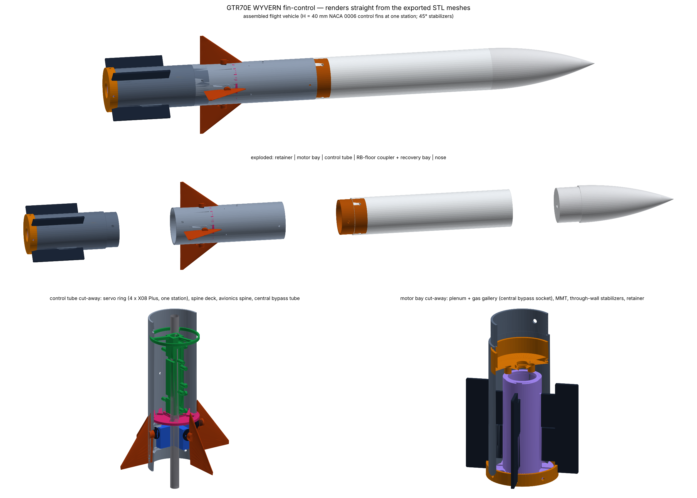

# GTR70E WYVERN — fin-controlled research rocket

Authors: Swaroop Sahoo, Chris Liu, Allison Hong

A single-stage, 58 mm, actively stabilised rocket. Four servo-driven triangular fins sit in one ring just above the motor, all at the same station, and steer it on ascent; four fixed rectangular stabilizers run the length of the motor and keep it passively stable. The motor's ejection gas reaches the recovery bay through an aluminium tube on the centreline, and the avionics ride on a square spine around that tube. The flight computer is an Adafruit Feather RP2040 with an onboard 915 MHz LoRa radio, which streams telemetry live to a ground station. The thrust-vector-control revision lives, complete, in `TVC ARCHIVED/`.



## Key numbers (`Documentation/CANONICAL_NUMBERS.md` is the full, generated list)

| | |
|---|---|
| Length / OD | 692 mm / 58 mm, four printed sections (each fits a 256 mm printer), only the nose separates |
| Liftoff mass | 806.7 g on an AeroTech Econojet F42-4T (T/W 4.6 avg; 4 motors $87.98, no certification) |
| CG / CP / margin | 360 / 418 mm, 1.01 cal at liftoff, 1.18 at burnout; 214 g nose ballast, stabilizers 81 x 20 mm at 45°, H45 flight fins |
| Rail exit | 14.8 m/s off the 6 ft Estes Pro Series II rail (an 8 ft rail would add margin) |
| Apogee | 167 m (549 ft, under the 600 ft cap) at 6.2 s; motor ejection (4 s delay) via the central 3/8 in bypass tube |
| Control | 4 x KST X08 Plus in one ring, bases 5 mm from the axis, ±15°, q-scheduled PID at 200 Hz; gust case 0.44° RMS tilt vs 10.4° with fins locked; fins active from rail exit until q̄ < 15 Pa (88 % of the ascent); in-flight authority manoeuvre (doublets + 1° steps) |
| Avionics | Feather RP2040 RFM95, BNO085 + ADXL375 (core 0 bus), BME688 (core 1 bus) and microSD on a square spine around the bypass tube; a second Feather RP2040 RFM95 is the ground station |
| Power | 2S 450 mAh, internal screw switch on a MOSFET switch; 26-min mission uses 57 mAh (4.3x margin) |
| Telemetry | LoRa SF7 / 500 kHz: 42-byte state frames at 20 Hz, manoeuvre result after coast; 57 dB margin at worst slant range |

## Research questions (`Documentation/Research_Plan.md`)

Main question: how do aerofoil section (flat plate, 6 % double wedge, NACA 0006, NACA 0012) and fin height (20-40 mm) set the control authority of a servo-actuated triangular fin, and which combination gives the most? Tunnel Phase A (one fin on a reflection plane) plus simulation.

- SQ1: how much do the rectangular stabilizers reduce installed authority, as a function of span and azimuth? `wf_stabilizer.py` plus tunnel Phase B (full finset, stabilizers off / 30 / 40 mm).
- SQ2: how well do the simulations predict the tunnel, and how far does that carry to flight? Three launches of the best section at H* - 5, H*, H* + 5.

## Repository

```
GTR70E WYVERN/
├── README.md
├── Documentation/
│   ├── Design_Overview.md          architecture, servo ring, spine, stability/ballast, motor, bypass sizing
│   ├── Research_Plan.md            main RQ + SQ1/SQ2, single fin vs four, test matrix, selection rule
│   ├── Wind_Tunnel_Adaptation.md   Phase A half-model (stock section), Phase B 200 x 200 x 750 + stabilizer tail
│   ├── Electronics_Telemetry.md    board choice, pin map, power + battery budget, LoRa, firmware
│   ├── Build_and_Test.md           print settings, assembly stages, sign check, ejection test, pad procedure
│   ├── Decisions_and_Risks.md      decision log + risk register
│   ├── CANONICAL_NUMBERS.md        generated by gen_canonical_md.py
│   ├── WYVERN_FIN_BOM.xlsx         built by build_bom.py (to-buy flight, to-buy tunnel, on hand, retired)
│   └── diagrams/                   D0 renders, D1 layout, D2 sections, D3 assembly, D4 tunnel, D5 research plan, D6 fit check
├── 3D parts/
│   ├── _generator/                 gen_wyvern_fin.py (CadQuery), gen_fit_assembly.py (fit check), mass_report.json
│   ├── vendor/                     Adafruit + Pololu STEP models of the bought boards
│   ├── flight/                     STEP + STL for every printed flight part
│   ├── control_fins/<profile>/     4 profiles x H20-45
│   ├── wind_tunnel/                WTA_* Phase A panel/cradle/transition, WTB_* stabilizer tail + blades, WT_* Phase B
│   └── assembly/                   full assembly STEP + STL, fit-check assembly + FIT_REPORT.md
├── Simulations/
│   ├── wf_core.py                  single source of truth (geometry, masses, motors, aero, spine board layout)
│   ├── motors/                     RASP .eng curves from thrustcurve.org (F67W, F67C, G74W, F50T, G40W)
│   ├── wf_flightsim.py             3-DOF closed-loop flight sim + motor trade + gain tuning + authority manoeuvre
│   ├── wf_fin_authority.py         4 x 8 profile/height authority sweep (main RQ)
│   ├── wf_stabilizer.py            stabilizer span x azimuth sweep (SQ1)
│   ├── wf_stabilizer_planform_trade.py  equal-span / AIM-54 layout trade (S4 plot)
│   ├── wf_apogee_cap_trade.py      rev 3d: 600 ft cap without losing authority (C plot)
│   ├── wf_motor_study.py           F42-4T vs F27R-4 / F20W-4 / F20W-7 on 6-10 ft rails (D plot)
│   ├── wf_bypass.py · wf_power.py · wf_link_budget.py
│   ├── wyvern_finsim/              GUI simulation & dataset suite (run_gui.py), headless datagen.py
│   └── CFD/                        vortex-panel 2D + vlm.py 3D vortex lattice + simscale/ RANS package (10 cases)
├── Flight Computer/
│   ├── firmware/wyvern_fin/        flight firmware (arduino-pico, compiles)
│   ├── ground_station/             second Feather RP2040 RFM95 receiver, host recorder
│   ├── test_code/                  t1 I2C scan, t2 servo cal / tunnel sweep, t3 LoRa range
│   └── wiring/                     gen_wiring.py -> W1 wiring, W2 power tree, W3 system, W4 spine + perfboard
├── Wind Tunnel/                    Jerrod H STLs (unchanged) + wt_balance_daq firmware
├── Motor Test Stand/               static thrust stand (reused)
├── Data/                           Flight / Motor / Wind Tunnel (empty until testing)
├── Paper/
└── TVC ARCHIVED/                   everything from the TVC revision that is not reused
```

## Re-running the cascade

```bash
pip install cadquery numpy-stl matplotlib openpyxl
cd "3D parts/_generator" && python3 gen_wyvern_fin.py          # CAD + mass_report.json (~25 s)
python3 gen_fit_assembly.py                                     # fit check with vendor models (~2 min)
cd ../../Simulations
python3 wf_core.py --report                                    # canonical_numbers.json
python3 CFD/run_airfoil_cfd.py && python3 CFD/vlm.py
python3 wf_flightsim.py            # add --retune after any mass/geometry change
python3 wf_fin_authority.py        # ~1 min
python3 wf_stabilizer.py           # ~20 s
python3 wf_stabilizer_planform_trade.py
python3 wf_apogee_cap_trade.py && python3 wf_motor_study.py
python3 wf_bypass.py && python3 wf_power.py && python3 wf_link_budget.py
cd ../Documentation && python3 gen_canonical_md.py && python3 build_bom.py
cd diagrams && python3 gen_vehicle_drawings.py && python3 gen_cad_renders.py && python3 gen_tunnel_research.py && python3 gen_fit_render.py
cd "../../Flight Computer/wiring" && python3 gen_wiring.py
```

Then re-run `python3 "Flight Computer/firmware/sil_host/sil_check.py"` (firmware vs sim manoeuvre metrics) and `python3 Simulations/CFD/simscale/gen_simscale.py` if the geometry changed. Copy any changed gains or limits into `Flight Computer/firmware/wyvern_fin/fc_config.h` and run `python3 sync_headers.py`.
